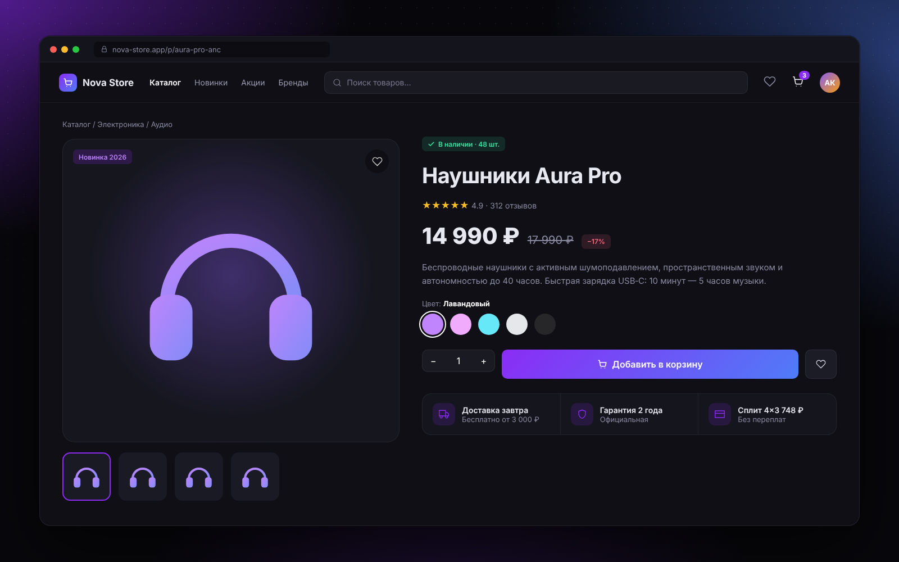
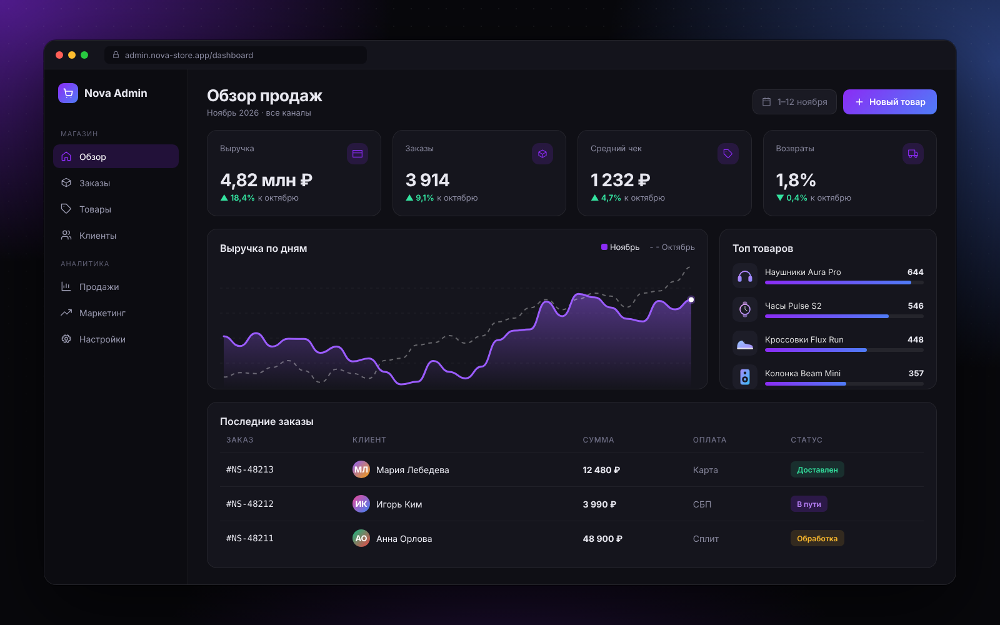

# Nova Store

**Демо интернет-магазина: каталог, карточка товара, корзина, оформление заказа и панель администратора.**
Проект из портфолио [NSSoftDev](https://nssoftdev.com).

🔗 **Живое демо:** https://nssoftdev.github.io/nova-store/


## Возможности

### Витрина
- **Каталог с фильтрами:** категории, двойной ползунок цены, рейтинг, сортировка, живой поиск (клавиша `/`), подборки «Новинки», «Акции», «Избранное», страница брендов.
- **Карточка товара:** выбор цвета перекрашивает иллюстрацию, четыре ракурса, количество, характеристики и отзывы, блок «С этим покупают».
- **Корзина:** выезжающая панель, изменение количества, удаление товаров. Корзина сохраняется между визитами.



### Оформление заказа
Четыре шага: **Корзина → Доставка → Оплата → Готово**.
- Курьер, экспресс-доставка или пункт выдачи, выбор интервала. Бесплатная доставка от порога, который задаётся в админке.
- **Банковская карта:** живое превью карты, определение платёжной системы (VISA / Mastercard / МИР), проверка номера по алгоритму Луна и срока действия.
- **СБП:** QR-код. **Сплит:** график из четырёх платежей.
- **Промокоды:** `SOUND20` (−20 % на аудиотовары) и `NOVA10` (−10 % на заказ от 5 000 ₽).
- Тестовая карта: `4242 4242 4242 4242`, любое имя латиницей, срок в будущем, любой CVC. Её также можно подставить кнопкой «Заполнить тестовой картой».


### Nova Admin
- **Обзор:** KPI в сравнении с прошлым периодом, график выручки (текущий и предыдущий период) с подсказкой при наведении, топ товаров, последние заказы.
- **Заказы:** фильтр по статусу, поиск, смена статуса прямо в таблице.
- **Товары:** правка цены и остатка в таблице, скрытие товара с витрины, создание нового товара с превью.
- **Клиенты**, **Продажи** (выручка по категориям, доля способов оплаты), **Маркетинг** (включение и выключение промокодов), **Настройки**.

Витрина и админка работают с одними данными: заказ, оформленный в магазине, сразу появляется в админке. Скрытый товар исчезает из каталога, выключенный промокод перестаёт приниматься в корзине.



## Технологии

- HTML, CSS, JavaScript (ES2020) без фреймворков и сборки: открывается двойным кликом по `index.html` или с любого статического хостинга.
- Hash-роутинг (`#/p/aura-pro-anc`, `#/checkout`, `#/admin/orders` …).
- Состояние хранится в `localStorage` с простой подпиской на изменения и синхронизируется между вкладками.
- Безопасные шаблоны с автоматическим экранированием (`Nova.html`).
- Все иллюстрации товаров и графики нарисованы в SVG кодом, без внешних картинок.
- Адаптивная вёрстка (десктоп, планшет, телефон), работа с клавиатуры, поддержка `prefers-reduced-motion`.

## Структура

```
index.html          точка входа
css/styles.css      дизайн-система и все экраны
js/icons.js         иконки интерфейса и SVG-иллюстрации товаров
js/data.js          каталог, промокоды, история продаж (seed)
js/store.js         состояние, корзина, расчёт цены, форматирование, тосты
js/shop.js          шапка, каталог, карточка товара, бренды, корзина
js/checkout.js      оформление заказа и оплата
js/admin.js         Nova Admin
js/app.js           роутер, оболочки, делегирование событий
screenshots/        скриншоты для README
```

## Запуск локально

```bash
git clone https://github.com/NSSoftDev/nova-store.git
cd nova-store
# любой статический сервер, например:
python -m http.server 8080
# → http://localhost:8080
```

Можно просто открыть `index.html` в браузере. Сбросить демо-данные: меню аватара → «Сбросить демо-данные» или «Настройки» в админке.

## Лицензия

[MIT](LICENSE) © 2026 Nikolay Savosin / NSSoftDev
