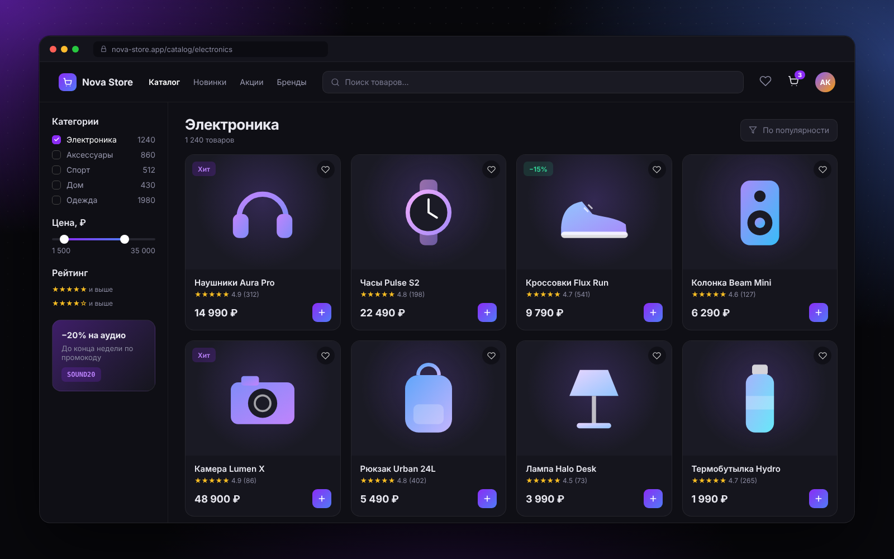
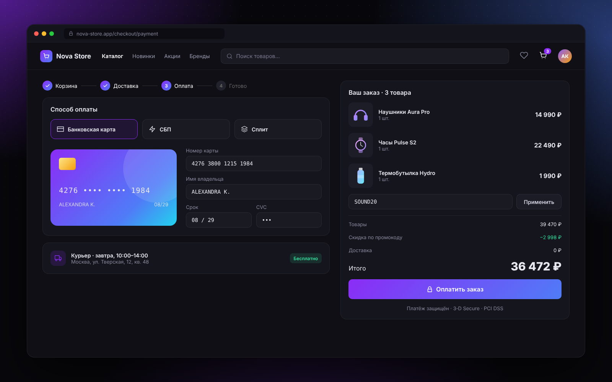

# Nova Store

**Интернет-магазин электроники и lifestyle-товаров: витрина, оформление заказа и панель администратора.**
Стек: **React · Node.js (Express) · PostgreSQL**. Проект из портфолио [NSSoftDev](https://nssoftdev.com).

🔗 **Живое демо:** https://nssoftdev.com/demos/nova-store/
(статическая сборка того же React-клиента: данные хранятся в браузере, сервер не нужен)



## Возможности

**Витрина**
- Каталог: фильтры по категориям, двойной ползунок цены, рейтинг, сортировка, поиск (клавиша `/`), подборки «Новинки», «Акции», «Избранное», страница брендов.
- Карточка товара: смена цвета перекрашивает иллюстрацию, четыре ракурса, характеристики и отзывы, блок «С этим покупают».
- Корзина в выезжающей панели. Корзина и избранное сохраняются между визитами.

**Оформление заказа** в четыре шага: Корзина → Доставка → Оплата → Готово.
- Курьер, экспресс-доставка или пункт выдачи. Порог бесплатной доставки задаётся в админке.
- Оплата картой (живое превью, VISA/Mastercard/МИР, проверка Луна и срока), через СБП (QR-код) или Сплитом (график из 4 платежей).
- Промокоды `SOUND20` (−20 % на аудио) и `NOVA10` (−10 % от 5 000 ₽). Тестовая карта: `4242 4242 4242 4242`.
- **Итог считает сервер:** API заново находит цены в базе, проверяет остатки и промокод, а суммам из браузера не доверяет. Данные карты на сервер не отправляются.



**Nova Admin** (`/#/admin`, вход по токену)
- Обзор: KPI в сравнении с прошлым периодом, график выручки (текущий и предыдущий период) с подсказкой, топ товаров, последние заказы.
- Заказы: фильтр, поиск, смена статуса. Товары: правка цены и остатка в таблице, скрытие с витрины, создание нового товара.
- Клиенты, продажи по категориям и способам оплаты, промокоды (вкл/выкл), настройки.


## Архитектура

```
nova-store/
├─ shared/            @nova/shared — общий код клиента и сервера
│  └─ src/            каталог-сид, движок цен (промокоды, доставка), аналитика
├─ server/            @nova/server — REST API на Express + PostgreSQL
│  ├─ db/migrations/  SQL-схема (таблицы, ограничения, индексы)
│  ├─ scripts/        migrate.js, seed.js
│  ├─ src/            app.js, routes/, repository.js (весь SQL), db.js
│  └─ test/           интеграционные тесты на настоящем PostgreSQL
├─ client/            @nova/client — React 19 + React Router + Vite
│  └─ src/
│     ├─ api/         http.js (REST) и demo.js (localStorage) с одним интерфейсом
│     ├─ state/       ShopContext: каталог, корзина, избранное, промокод, уведомления
│     ├─ pages/       Catalog, Product, Brands, Checkout, admin/*
│     └─ components/  Header, ProductCard, CartDrawer, ShopLayout, …
├─ docker-compose.yml PostgreSQL + API + nginx с клиентом
└─ .github/workflows/ci.yml   тесты на PostgreSQL и обе сборки клиента
```

Клиент выбирает адаптер данных при сборке: `VITE_API_MODE=http` для работы с API (по умолчанию) или `demo` для автономной сборки. Бизнес-правила (цены, скидки, доставка, аналитика) лежат в `@nova/shared`, поэтому оба режима считают одинаково.

### REST API

| Метод | Путь | Описание |
|---|---|---|
| GET | `/api/health` | Состояние API и базы |
| GET | `/api/catalog` | Категории, видимые товары, публичные настройки |
| GET | `/api/products/:id` | Товар |
| POST | `/api/promos/validate` | Проверка промокода для корзины |
| POST | `/api/orders` | Оформление заказа (транзакция, блокировка строк, пересчёт итогов) |
| GET/POST/PATCH | `/api/admin/products[/:id]` | Товары: список, создание, цена / остаток / видимость |
| GET/PATCH | `/api/admin/orders[/:id]` | Заказы: список с фильтром и поиском, смена статуса |
| GET | `/api/admin/stats?range=12d\|7d\|30d` | KPI и ряды для графика |
| GET | `/api/admin/customers`, `/api/admin/sales` | Клиенты, структура продаж |
| GET/PATCH | `/api/admin/promos[/:code]` | Промокоды |
| PATCH | `/api/admin/settings` | Порог бесплатной доставки |

Маршруты `/api/admin/*` требуют заголовок `Authorization: Bearer <ADMIN_TOKEN>` (токен проверяется сравнением за постоянное время).

## Запуск

Нужны Node.js 20+ и PostgreSQL 14+ (или Docker).

```bash
git clone https://github.com/NSSoftDev/nova-store.git
cd nova-store
npm install

# База и API
cp server/.env.example server/.env        # укажите DATABASE_URL и ADMIN_TOKEN
export $(grep -v '^#' server/.env | xargs)
npm run db:migrate && npm run db:seed
npm run dev:api                           # http://localhost:4000/api

# Клиент (во втором терминале)
npm run dev                               # http://localhost:5173, /api проксируется на :4000
```

**Через Docker:** `docker compose up --build`, затем `docker compose exec api node scripts/seed.js` → http://localhost:8080.

**Демо без сервера:** `npm run build:demo`. Готовая сборка `client/dist/` открывается с любого статического хостинга, в том числе из подпапки.

## Тесты

```bash
npm test
```

21 тест: движок цен и API против **настоящего PostgreSQL**. Проверяются пересчёт итогов на сервере, остатки, промокоды, скрытые товары, права админа, аналитика и настройки. Если `TEST_DATABASE_URL` не задан, тесты сами поднимают временный PostgreSQL через `embedded-postgres`. В CI используется сервис-контейнер `postgres:16`.

## Лицензия

[MIT](LICENSE) © 2026 Nikolay Savosin / NSSoftDev
